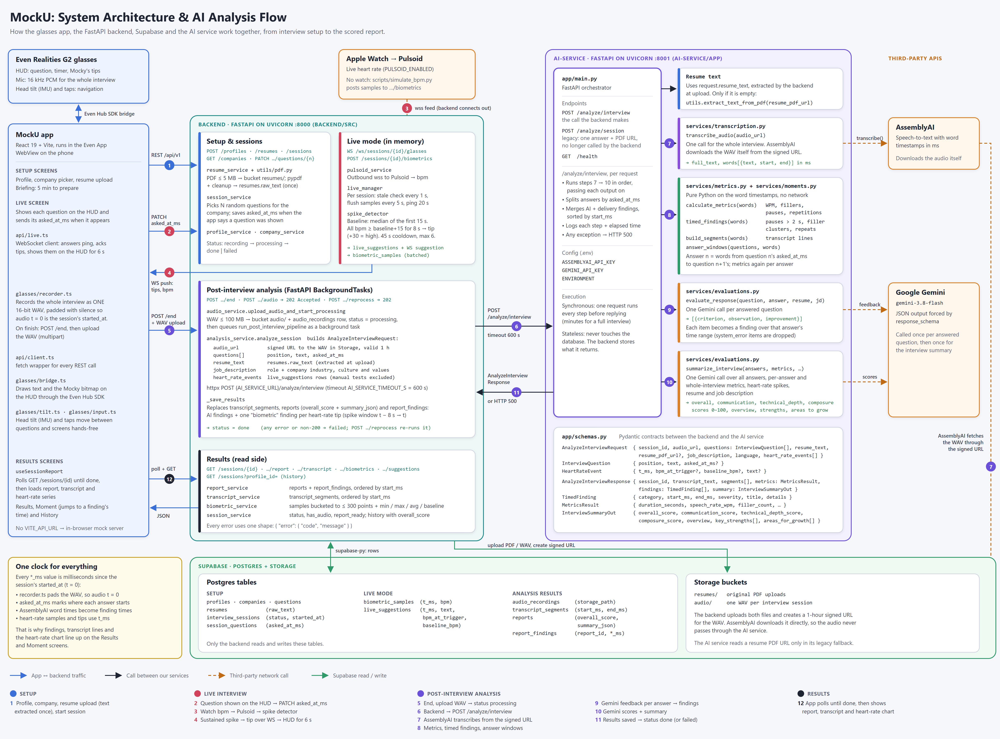

# MockU AI Service

The AI service turns a recorded mock interview into a scored report. The backend sends it one audio file for the whole interview, the questions with the time each one was shown, the resume text, the job description and any heart-rate spikes. The service returns:

- the **transcript**, split into timed segments,
- **delivery metrics** for the whole interview (speaking pace, filler words, long pauses, repetitions),
- **timed findings**: pauses, filler clusters, repeated words, and AI feedback on each answer, each with a start and end time,
- a **summary**: four 0–100 scores, a one-line overview, strengths and areas for growth.

It is a single, stateless FastAPI app on port 8001. Only the MockU backend (Python FastAPI, port 8000) calls it. The backend owns the database and stores what this service returns.

## Architecture



> The diagram is made from [docs/architecture.html](./docs/architecture.html). To update it, edit that file and re-render it (the command is in the comment at the top of the file).

### Where the AI service sits

| Layer | Code | Role in the analysis |
|-------|------|----------------------|
| **Glasses + app** | [src/](../src) (React + Vite in the Even App WebView) | Shows the questions on the Even Realities G2 HUD, reports when each question appears (`asked_at_ms`), records the whole interview as one WAV whose t = 0 is the session start, uploads it, and polls for the report. |
| **Backend** | [Backend/src/](../Backend/src) (FastAPI, `:8000`) | Stores the resume text, runs live heart-rate tips, uploads the WAV to Supabase Storage, then calls this service from a background task and saves the result. |
| **Supabase** | Postgres + Storage | Holds every table and both buckets (`resumes/`, `audio/`). Only the backend reads and writes it. |
| **AI service** | [app/](./app) (FastAPI, `:8001`) | Transcribes, measures, finds timed moments and asks Gemini for feedback and scores. It keeps nothing between requests. |
| **Third-party APIs** | AssemblyAI, Google Gemini, Pulsoid | Speech-to-text, LLM feedback, and live heart rate from an Apple Watch (Pulsoid is called by the backend, not by this service). |

### Components

| Component | File | Responsibility |
|-----------|------|----------------|
| **API / orchestrator** | [app/main.py](./app/main.py) | Exposes `POST /analyze/interview`, the legacy `POST /analyze/session` and `GET /health`. Runs the steps in order, passes each output to the next, merges and sorts the findings, and turns any failure into an HTTP 500. |
| **Contracts** | [app/schemas.py](./app/schemas.py) | Pydantic models: `AnalyzeInterviewRequest` (with `InterviewQuestion`, `HeartRateEvent`), `AnalyzeInterviewResponse` (with `TranscriptSegmentOut`, `MetricsResult`, `TimedFinding`, `InterviewSummaryOut`), plus the legacy `AnalyzeRequest` / `AnalyzeResponse`. |
| **Resume extraction** | [app/services/utils.py](./app/services/utils.py) | Fallback only. The backend already sends `resume_text`; if it is empty and a `resume_pdf_url` is given, this downloads the PDF and extracts the text with `pypdf`. |
| **Transcription** | [app/services/transcription.py](./app/services/transcription.py) | Sends the audio URL to **AssemblyAI**, which downloads the file itself. Waits for the result and returns the full text plus each word with start/end times in milliseconds. |
| **Metrics** | [app/services/metrics.py](./app/services/metrics.py) | Plain Python. Duration, words per minute, filler words (English or Spanish list), pauses longer than 2 s, back-to-back repeated words. Runs once for the whole interview and once per answer. |
| **Moments** | [app/services/moments.py](./app/services/moments.py) | Plain Python. `build_segments` groups words into transcript lines. `timed_findings` finds long pauses, filler clusters and repetitions with exact times. `answer_windows` splits the words into one answer per question using `asked_at_ms`. |
| **Evaluation** | [app/services/evaluations.py](./app/services/evaluations.py) | Two **Google Gemini** (`gemini-3.8-flash`) calls, both with a response schema that forces JSON. `evaluate_response` gives feedback on one answer. `summarize_interview` scores the whole interview. |

### External dependencies

| Service | Used for | Called from |
|---------|----------|-------------|
| Supabase Storage | Hosts the interview WAV (`audio/`) and resume PDFs (`resumes/`). The backend gives this service a 1-hour signed URL for the WAV. | AssemblyAI (audio download), `utils.py` (legacy PDF fallback) |
| AssemblyAI | Speech-to-text with word-level timestamps | `transcription.py` |
| Google Gemini | Per-answer feedback and the interview summary | `evaluations.py` |

## Data flow

The numbers match the badges in the diagram.

**Setup**

1. **Profile, resume, session.** The candidate creates a profile, picks a company and uploads a resume. The backend stores the PDF in the `resumes/` bucket and extracts its text once into `resumes.raw_text`. Starting a session picks the questions and fixes `started_at`, which is t = 0 for every `*_ms` value from then on.

**Live interview**

2. **Questions.** Each time a question appears on the glasses, the app sends `PATCH /sessions/{id}/questions/{n}` with `asked_at_ms`. The glasses mic records the whole interview.
3. **Heart rate.** The backend reads the Apple Watch through Pulsoid's WebSocket (or a simulator posts samples). `spike_detector` sets a baseline from the first 15 s and watches for a spike that lasts 8 s.
4. **Live tips.** A spike creates a `live_suggestions` row and a tip pushed over the WebSocket to the HUD. These rows are the `heart_rate_events` sent in step 6.

**Post-interview analysis**

5. **Upload.** The app ends the session and uploads the WAV. The backend stores it in the `audio/` bucket, sets the status to `processing` and starts a background task.
6. **Request analysis.** `analysis_service` builds an `AnalyzeInterviewRequest` (signed audio URL, questions with `asked_at_ms`, resume text, a job description built from the role and the company's industry, culture and values, and the heart-rate events) and posts it to `/analyze/interview` with a 600 s timeout.
7. **Transcribe.** `transcribe_audio` sends the signed URL to AssemblyAI, which downloads the WAV and returns `full_text` and `words[]` with timestamps.
8. **Measure and split.** `calculate_metrics`, `timed_findings` and `build_segments` run on all the words. `answer_windows` splits them into answers: answer *n* is every word between question *n*'s `asked_at_ms` and question *n+1*'s. Metrics are computed again for each answer.
9. **Per-answer feedback.** For each answer that has words, `evaluate_response` asks Gemini for `{criterion, observation, improvement}` items. Each item becomes a finding that covers that answer's time range.
10. **Summary.** `summarize_interview` sends every answer, the metrics, the heart-rate spikes, the resume and the job description to Gemini and gets back the four scores, an overview, strengths and areas for growth.
11. **Respond and save.** `main.py` returns an `AnalyzeInterviewResponse`. The backend replaces `transcript_segments`, `reports` and `report_findings` (adding one `biometric` finding per heart-rate tip) and sets the status to `done`. On any error or non-200 response it sets `failed`, and `POST /sessions/{id}/reprocess` runs the analysis again.

**Results**

12. **Show the report.** The app polls `GET /sessions/{id}` until the status is `done`, then loads the report, transcript and heart-rate series. Because everything shares the same clock, findings, transcript lines and the heart-rate chart line up.

## API

### `POST /analyze/interview`

Request:

```json
{
  "session_id": "e83726a1-9492-4f9e-a868-d069c9b1392e",
  "audio_url": "https://<project>.supabase.co/storage/v1/object/sign/audio/audio/e83726a1.wav?token=...",
  "questions": [
    { "position": 1, "text": "Tell me about a time you disagreed with a teammate.", "asked_at_ms": 2500 },
    { "position": 2, "text": "Walk me through a project you're proud of.", "asked_at_ms": 95000 }
  ],
  "resume_text": "Alex Rivera - Software Engineer intern...",
  "resume_pdf_url": null,
  "job_description": "SWE Intern at Stripe. Industry: Fintech. Culture: High ownership...",
  "language": "en",
  "heart_rate_events": [
    { "t_ms": 68000, "bpm_at_trigger": 112, "baseline_bpm": 78, "text": "Take a slow breath" }
  ]
}
```

- Questions with `asked_at_ms: null` were never shown and are skipped.
- `resume_pdf_url` is only read when `resume_text` is empty.
- `language` is `"en"` (default) or `"es"`. It selects the filler-word list. The backend currently always sends `"en"`.

Response:

```json
{
  "session_id": "e83726a1-9492-4f9e-a868-d069c9b1392e",
  "transcript_text": "So in my last internship...",
  "segments": [
    { "start_ms": 6100, "end_ms": 11800, "text": "So in my last internship we had a sprint where" }
  ],
  "metrics": {
    "duration_seconds": 412.6,
    "speech_rate_wpm": 138,
    "filler_count": 14,
    "long_pause_count": 5,
    "repetitions_count": 3
  },
  "findings": [
    {
      "category": "fillers",
      "start_ms": 20100,
      "end_ms": 26400,
      "severity": "medium",
      "title": "4 filler words",
      "details": { "note": "You said like, um 4 times in a few seconds. ...", "count": 4, "words": ["like", "um"] }
    },
    {
      "category": "clarity",
      "start_ms": 6100,
      "end_ms": 91200,
      "severity": "medium",
      "title": "Clarity",
      "details": {
        "note": "The situation is clear, but the outcome comes late. Use STAR: state the result first.",
        "observation": "The situation is clear, but the outcome comes late.",
        "improvement": "Use STAR: state the result first.",
        "question": "Tell me about a time you disagreed with a teammate."
      }
    }
  ],
  "summary": {
    "overall_score": 74,
    "communication_score": 70,
    "technical_depth_score": 76,
    "composure_score": 78,
    "overview": "You gave concrete examples but buried your results.",
    "key_strengths": ["You owned your decisions and explained the trade-offs."],
    "areas_for_growth": ["Lead with the outcome before the details."]
  }
}
```

Finding categories are `pauses`, `fillers`, `restarts`, or a Gemini criterion such as `clarity`. The backend adds `biometric` findings itself.

### `POST /analyze/session` (legacy)

Analyzes a single answer: `{session_id, question, audio_url, resume_pdf_url, job_description, language}` in, `{session_id, metrics, transcript_text, feedback[]}` out. The backend no longer calls it. It is kept for testing one answer on its own.

### `GET /health`

Returns `{"status": "ok", "environment": "<ENVIRONMENT>"}`.

## Running locally

```bash
cd ai-service
python -m venv .venv
# Windows: .venv\Scripts\activate    macOS/Linux: source .venv/bin/activate
pip install -r requirements.txt
```

Create `ai-service/.env` (see [.env.example](./.env.example)):

```env
ENVIRONMENT=dev
ASSEMBLYAI_API_KEY=your-assemblyai-key
GEMINI_API_KEY=your-gemini-key
```

Start the server on port 8001, because the backend uses 8000:

```bash
uvicorn app.main:app --reload --port 8001
```

The interactive API docs are then at http://localhost:8001/docs.

The backend finds this service through two settings in `Backend/.env`:

```env
AI_SERVICE_URL=http://127.0.0.1:8001
AI_SERVICE_TIMEOUT_S=600
```

Two scripts test parts of the pipeline on their own: [test_transcription.py](./test_transcription.py) and [test_metrics.py](./test_metrics.py).

## Design notes

- **One recording, split by time.** The app records the whole interview as one WAV that starts at the session's t = 0, so it is transcribed once. `asked_at_ms` then splits it into answers. This needs fewer AssemblyAI calls than one upload per answer, and every finding has a time on the same clock as the transcript and heart-rate chart.
- **Stateless service.** The AI service never touches the database. The backend gathers the context, calls it, and stores the result, so re-running an analysis only needs `POST /sessions/{id}/reprocess` on the backend.
- **Synchronous pipeline, async caller.** One request runs every step, including waiting on AssemblyAI and one Gemini call per answer plus one for the summary. A full interview can take a few minutes. The backend calls it from a background task with a 600 s timeout, and the app polls the session status.
- **Metrics vs. AI feedback.** Delivery metrics and timed moments come from the word timestamps alone, so the same audio always gives the same numbers. Gemini is only used to judge the *content* and to write the summary.
- **Errors.** If a per-answer Gemini call fails, that answer gets no AI findings (its `system_error` item is dropped) and the rest continues. If transcription or the summary fails, the request returns HTTP 500 and the backend marks the session `failed`.
